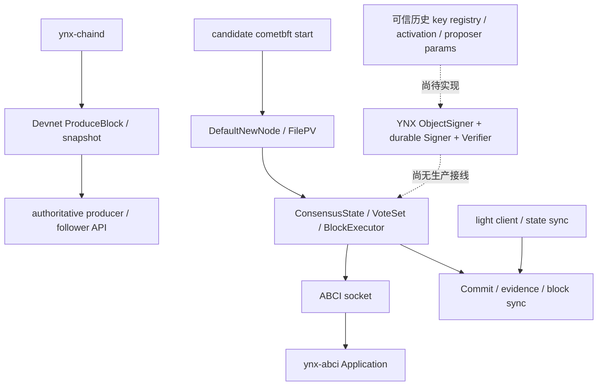

# CometBFT 0.38.23 双 PQ 引擎接入盘点 R1

状态：源码盘点与下一切片建议。未修改引擎、签名限制、依赖或已冻结源码，未在本机执行 Go/C 编译、测试或节点。此文不表示部署、BFT 切换或 light-client 验证完成。

## 1. 取证基线与当前运行边界

- YNX checkout：`/Users/huangjiahao/.codex/worktrees/ynx-pq-public-upgrade/YNX Chain`，源码读取基线 `69e788b4bd726689ea5d1709fd5ba0162c6ec0da`；交付时 HEAD 为 `dbf3b850cff086a505b17ff5bf74f1f3a84b88f7`，两者差异仅三个 evidence JSON，无本盘点代码变化。下文 `YNX:` 路径相对此根。
- Comet 固定源码：`/Users/huangjiahao/go/pkg/mod/github.com/cometbft/cometbft@v0.38.23`。下文 `Comet:` 路径相对此根；未使用同机其他版本。
- `YNX:go.mod:7` 固定 `github.com/cometbft/cometbft v0.38.23`；`go.sum:45` 模块校验和为 `h1:jtCe5Do4EcHVf/FCyZMvkBm+AmsRGGyvswImXYAabdM=`；go.mod 校验和为 `h1:jtH//cs5e2U5dNiaYIPMBwWXZsedXJfIie77gVhuRaA=`。
- 本轮读取父协调者保存的 `YNX:docs/protocol/evidence/CI_RUN8_39059614316.json`：源码 `69e788b4` 的 Run8/focused-go 为 completed/success，含 pure、Chain/API、entrypoint compile、state bridge 等步骤；另一个 `verify` job 为 skipped。本轮未重新调用 GitHub 或重跑测试。ObjectSigner 组件测试的成功不是引擎接入证据。

**现有 `ynx-chaind` 是 authoritative producer/follower 路径。** `YNX:cmd/ynx-chaind/main.go:150` 的 `runNode` 创建 `chain.NewPersistentDevnetWithValidatorsAndPeers`，调用 `Devnet.StartWithPause`，启动 replication/peer-sync 和 API。`replicationMode` 明确输出 `authoritative_producer` / `authoritative_follower`。`YNX:internal/chain/devnet.go` 的 `ProduceBlock` 选择 producer、收录 pending、生成区块/系统日志并持久化；没有 Comet vote quorum。源码中不存在该入口创建 `node.NewNode`、ConsensusState 或 PrivValidator 的调用。这里的 durable ACK、区块 hash、replication 与 account PQ 证明均不能被称为 BFT commit/light proof。本盘点没有核实任何远端实际进程或当前部署配置。

**另一条候选路径才启动 Comet。** `YNX:cmd/ynx-abci/main.go:35` 加载迁移 JSON，创建 `consensus.NewPersistentApplication` 和 ABCI socket/grpc server；它自己不运行共识引擎。`YNX:internal/consensus/production.go:560` 生成两个 candidate systemd 服务：`ynx-abci` 和独立的 `.../bin/cometbft start --home .../consensus-candidate`。这套源码/打包入口不是现网切换证据。

## 2. 实际构建入口与信任来源

| 环节 | 实际源码 | 现状与必要边界 |
|---|---|---|
| CLI → node | `Comet:cmd/cometbft/main.go:45`，`cmd/cometbft/commands/run_node.go:97` | stock CLI 注入 `node.DefaultNewNode`。可以在 YNX 自己的 candidate command 提供 node provider；不需要复制整个引擎，但单独换 command 不会改验证路径。 |
| 默认 PV | `Comet:node/setup.go:64` | `LoadOrGenFilePV` 后传入 `node.NewNode`；当前 YNX key ceremony/network 也调用 `privval.GenFilePV`，生成传统 Ed25519。新 PQ 节点必须显式提供 durable signer 适配器，禁止缺配置时退回/自动生成 FilePV。 |
| node 装配 | `Comet:node/node.go:267`、`:333`；`node/setup.go:307` | NewNode 建 state/block DB、proxy/handshake；若 `PrivValidatorListenAddr` 非空，替换为 socket signer client；随后 `GetPubKey`。`createConsensusReactor` 创建 `cs.NewState(state.Copy(),...)` 并 `SetPrivValidator`。本地 PQ provider 必须处理或拒绝该 remote override。 |
| PV 接口 | `Comet:types/priv_validator.go` | 必须有 `GetPubKey() (crypto.PubKey,error)`、`SignVote`、`SignProposal`。当前 `ObjectSigner` 刻意只有后两者，不满足此接口，也没有合成 Ed25519 身份。 |
| genesis | `YNX:internal/consensus/genesis.go:15` | `BuildCometGenesis` 检查迁移 validator keys，将 bytes 转为 `ed25519.PubKey`，给出 migration height+1、`ynx_<chainID>-1`、默认 params。这里需要真实 PQ key type 与一致的 validator identity，不能把两把 PQ key cast 为 Ed25519。 |
| key ceremony / inventory | `YNX:internal/consensus/key_ceremony.go:32`、`:85`；`network.go:107`；`production.go:531` | 现在读写/校验 `privval.FilePVKey`、Ed25519 public record、地址及私公钥对应。必须独立适配双 PQ key 的持有证明、durable signer state、inventory 与离线交接；P2P node key 是另一身份。 |
| 迁移验证者 | `YNX:internal/chain/consensus_migration.go:301`、`:347`、`:359` | 目前仅接受 `tendermint/PubKeyEd25519`、32 B 公钥与对应 consensus address；完整 Runtime/account PQ 并不自动成为 validator PQ registry。新 schema 必须版本化、完整进入迁移 hash。 |
| ABCI 初始状态 | `YNX:internal/consensus/application.go:183`；`Comet:consensus/replay.go:326` | YNX InitChain 校验 chain/height/完整迁移，当前只回 AppHash。Comet handshaker 从 genesis 传 validators/params，若应用有返回 updates 可转换；当前应用没有返回 validator replacement。 |
| 后继 validator updates | `YNX:internal/consensus/application.go:544`、`:586`；`Comet:state/execution.go:297`、`:598`、`:624` | 当前 FinalizeBlock 只回 TxResults/AppHash。Comet 验 key type/power、PB2TM 转换并更新 NextValidators；在 H 返回的 validator update 从 **H+2** 生效，params update 从 **H+1** 生效。PQ key epoch、activation、退出/轮换不能把两种延迟混同。 |
| 历史状态 | `Comet:state/store.go:548`、`:656` | `LoadValidators(H)` / `LoadConsensusParams(H)` 与 blockStore 同高度事实供重放/证据。新 key records 必须可历史读取、复制后不可变；不能从最新 key、peer envelope 或本地今日配置反推历史资格。 |

源码检索确认，当前 `YNX:internal/consensus/**`、`internal/chain/**`、`cmd/**` 的非测试代码未 import `internal/ynxconsensusauth`，没有实际 `Registry.ConsensusKeysAt`、`ObjectSigningStateSource.ConsensusSigningStateAt` 或 `EvidenceStateSource` 生产实现。

`ObjectSigningStateSource` 的 proposer 来源必须是实际 H/R 的 `cs.Validators.GetProposer()` 与相同 H/R 的 membership/index/params 快照。round 会改变 proposer priority，不能仅凭当前高度的 app validator 列表推算。引擎调用签名时可能已持有 consensus mutex；source 不得反向获取同一把锁造成死锁。适合由引擎在锁内发布完整不可变视图，签名适配器读取该视图；不得用请求方 supplied proposer 或 extension bool 充当可信 source。

## 3. 公钥表示与上下文验证是协议修改

`Comet:crypto/crypto.go` 的 `PubKey` 只有 `Address/Bytes/VerifySignature(msg,sig)/Equals/Type`。`crypto/encoding/codec.go:19`、`:45` 与 `proto/tendermint/crypto/keys.proto` 仅编码 Ed25519 / Secp256K1 oneof；`types/params.go:28`、`:192` 限制类型名，默认 validator key type 是 Ed25519。

新增真实双 PQ 公钥类型至少要协调：

1. **身份与可信 binding 契约。** 冻结完整双公钥、epoch、chain、有效高度/撤销，以及原 validator authority 批准与两把新 key 的 PoP。当前候选 `KeyRecord` 以 20 B validator address 查询；它尚未定义新 Comet `PubKey.Address()` 的 wire/identity 规则。选择“新双钥派生新 consensus address”会改变 validator identity、轮换连续性和历史映射；选择“保持旧 logical address”则需要正式的 authenticated binding/key-type 规则。不能任取旧地址塞入一个伪 Ed25519 key。
2. **proto + JSON + hash。** 固定 fork 的 `keys.proto`、生成的 `keys.pb.go`、`crypto/encoding`、真实 key implementation/JSON 注册、params allowlist，以及 `types/validator.go:118` 的 `Validator.Bytes()` / ToProto / FromProto。`Validator.Bytes()` 将 SimpleValidator 中的 pubkey 和 power 进入 validator-set hash；新 keys 必须被 `ValidatorsHash`/`NextValidatorsHash` 完整承诺，不能只放未认证的外部 map。ABCI `ValidatorUpdate` 使用同一 proto key 类型。
3. **上下文验证接口。** 候选 Request 签的是独立域中的 chain/address/H/R/kind/epoch 与完整 canonical message，不是直接对 stock canonical bytes 签名。`PubKey.VerifySignature` 没有可信 activation/key history/proposer state 参数。尤其 stock `CanonicalVoteExtension` 只有 extension/H/R/chain，缺少本协议绑定的普通 vote 的 BlockID/timestamp/type；不能从这段 bytes 恢复完整普通 vote。

因此，仅实现一个 PubKey wrapper 并扩大字节限制不成立。固定 fork 应增加能够接收完整对象与可信状态的验证入口，旧 profile 在历史高度保留，PQ 高度使用真实 AND 验证；未知类型/epoch/缺历史时拒绝。库依赖方向要明确：Comet fork 不应反向 import YNX 的 `internal` 包形成 cycle；可由 fork 定义窄接口、YNX 提供实现，或另设独立公共 codec 包，具体包/API 需下一切片冻结。本轮不移动现有冻结库。

## 4. 必须贯通的验签调用图

| 路径 | 固定 Comet 调用点 | 接入要求 |
|---|---|---|
| 本地 proposal | `consensus/state.go:1204` → `PrivValidator.SignProposal` (`:1240`) | 真实 proposer 快照 → ObjectSigner → 同一个 durable Signer；签名/持久化全部成功才变更对象。不能另加 raw 私钥签名出口。 |
| 收到 proposal | `consensus/state.go:1903` / `:1924` | 当前直接以 `Validators.GetProposer().PubKey` 验 stock sign bytes。新入口应传完整 Proposal、可信 proposer、chain/H/R/profile，保留 POLRound、BlockID/part 数等原规则。 |
| 本地 vote | `consensus/state.go:2364` → `types/vote.go:415` `SignAndCheckVote` | WAL FlushAndSync 后构造 vote；trusted params 决定 ExtendVote。PQ adapter base+extension 都成功才回填；重启与相同 HRS exact retry 保留原签名。 |
| 收到普通 vote | `types/vote_set.go:185`、`:218` → `types/vote.go:222` | 先核 H/R/step、index/address/member，再对象式验签，再计票。保持 nil/absent、重复/冲突处理，不把验签成功当 quorum。 |
| vote extension | `consensus/state.go:2177`、`:2206`；`types/vote.go:246`、`:267` | 两处均需完整 vote-bound PQ extension 验证，不能只替换其中一处。`BlockExecutor.VerifyVoteExtension` 是 ABCI 业务检查，不能代替密码验证。trusted enable height 生效的非 nil precommit 即使 extension 为空也要签。 |
| full Commit | `types/validation.go:28`；`state/validation.go:102` | `LastValidators` 对 H-1 的 LastCommit；全部 present 签名核验，只有 commit flag 计目标块票权，严格 >2/3。保留 positional index/address、总票权溢出/重复约束。候选 `Verifier.VerifyCommit` 可作为语义基础，但尚未替换实际调用。 |
| block sync | `blocksync/reactor.go:505`、`:522` | 同时核第二块 LastCommit、首块 LastCommit 等原路径。当前 extended commit 先 EnsureExtensions，再 `ToCommit()` 核普通签名；ToCommit 去掉 extension，不能宣称这一步已核 PQ extension signature。扩展提交保存/后续使用前的验证义务需明确并补对应路径。 |
| duplicate-vote evidence | `evidence/verify.go:17`、`:55`、`:168`；`types/evidence.go` | pool 从 blockMeta 获取原时间、LoadValidators 获取原高度 set，再做两票验证。候选 VerifyDuplicateVoteEvidence 只覆盖对象认证/历史 power/time，仍需原 evidence age、future height、committed duplicate、canonical serialization 与 evidence pool/执行惩罚流程。 |
| light-client attack evidence | `evidence/verify.go:111`、`:124`、`:136` | 既有 common/trusted/冲突高度，trusting 和 all-signatures 路径均要适配。不能用普通 full-Commit adapter 替代不同 validator set 的重叠信任计算。 |
| light-client 初始化 | `light/client.go:362`、`:381` | pin 的 trusted height/hash、primary/witness、header/validator hash与 quorum 全保留；不能把 RPC 自报 key registry 当可信来源。 |
| light-client 更新 | `light/verifier.go:32`、`:87`、`:160`；`types/validation.go:62`、`:126`、`:142` | adjacent 绑定 prior NextValidatorsHash；non-adjacent 先按旧 trusted set 的地址统计 trust threshold，再核新 set >2/3；还保留时间/信任期/clock drift及 witnesses。PQ epoch/history 必须可从已认证的 header/key commitment 取得。 |
| state sync | `statesync/stateprovider.go:48`、`:89`、`:125` | 依赖 light client 验 height、height+1、height+2 并导出 app hash/sets/params；snapshot 应用 hash 与新 registry/proof state 都要连续。它不因 ABCI account snapshot 已支持 PQ 就自动可用。 |

`Comet:types/validation.go` 有单验与 batch verifier 两路：`shouldBatchVerify` 按 key type 选择 `crypto/batch/batch.go`。PQ 必须使用已实现的真实逐签双验或另经验证的真实批验，不能复用 Ed25519 batch verifier、跳过其中一支，或以“优化”漏过 all-signatures 证据路径。当前候选 `VerifyCommit` 要求完整 set 与 Commit 一一对应；light trusting 的 set 与 commit 不一定同长且按地址匹配，必须另保留原语义。

## 5. 资源边界不能只改两个常数

固定候选 `YNX:internal/ynxconsensusauth/envelope.go`：ML-DSA-87 公钥 2592 B / 签名 4627 B；SLH-DSA-SHA2-256f 公钥 64 B / 签名 49856 B；含 tag/version/epoch/分支 framing 的 envelope **54534 B**。普通签名和 extension 签名是两个 envelope，合计 **109068 B**，尚未加 vote/extension/transport framing。这是按源码常数计算的大小，不是 benchmark。

| 现有边界 | 固定源码 | 必要协同 |
|---|---|---|
| 64 B signature cap | `types/signable.go:12`；`types/proposal.go:76`；`types/vote.go:320` / `:343`；`types/block.go:685` / `:757` | Proposal、Vote、CommitSig、ExtendedCommitSig 及 FromProto/ValidateBasic 都必须按明确 profile 验精确 envelope。不要允许任意 54 KiB blob。 |
| Commit 空间估算 | `types/block.go:594` / `:608` | 旧 `MaxCommitSigBytes=109` 明含 64 B 签名；MaxDataBytes 减去 MaxCommitBytes。必须按 validator 数及真实 protobuf overhead 重算，且避免 block/evidence 空间溢出或负值。 |
| remote signer 10 KiB | `privval/signer_endpoint.go:95` | 单个 PQ signature 已超限；必须同时协商 profile、PubKey encoding、完整对象/budget和精确 response 绑定，再谈传输限额。 |
| consensus / WAL | `consensus/reactor.go:30`、`:144`；`consensus/wal.go:25`、`:318`、`:385` | 1 MiB message 与 WAL message cap 联动。候选允许 1 MiB extension payload，加双 signature 后超过现有 reactor cap；必须冻结合法 payload+framing 的总预算。 |
| evidence | `evidence/reactor.go:19`；`types/evidence.go`；params Evidence.MaxBytes | duplicate vote 两票、light attack 大 validator set/Commit 的大小分别计算；消息 cap、单 evidence 与块内 evidence 总预算一致。 |
| block sync / RPC / DB | `blocksync/msgs.go:16`，`blocksync/reactor.go:184`；`types/block.go` 的 proto 转换 | 完整 block/extended commit、validator set/RPC JSON、持久化与 replay 都需要有界解析和真长度用例。不能依赖 decode 后才检查来防止超额分配。 |

## 6. Remote signer 是单独接入门

`Comet:node/setup.go:614` 建 SignerClient/RetrySignerClient；`privval/signer_client.go:71` 通过 proto 公钥解码，`:97` / `:119` 请求签 vote/proposal，成功时直接以响应覆盖整个调用对象。`privval/signer_requestHandler.go` 只基于请求 chain 检查并调用 PV。`proto/tendermint/privval/types.proto` 没有可信 proposer/历史 params 证明或 profile negotiation。

后续 remote adapter 至少要：以真实 PQ GetPubKey 配合固定 wire type；把可信 registry/selection/params source 放在 signer 的信任边界内；认证 node↔signer endpoint；按完整 unsigned request 比较返回对象（只允许已约定签名字段变化）；重试只恢复原请求/原 durable state；UNKNOWN 或 extension 第二阶段失败不回部分可用 vote。peer/node 自报 enabled bool 不授予扩展签名资格。若只完成本地 provider，remote 配置应明确拒绝该 profile，不宣称 remote 可用。

P2P `node_key.json` / `Comet:p2p/key.go` / `p2p/conn/secret_connection.go` 是另外的 Ed25519 transport 身份与握手。validator 双 PQ 接入不会把网络握手自动改成 PQ；本轮范围不扩展到传输密码迁移，也不能据此称整个网络量子安全。

## 7. Repo 内可做与必须固定 fork 的边界

| 可在 YNX repo 实现 | 需要固定 Comet fork/vendor 同步 |
|---|---|
| committed validator PQ registration / epoch / activation schema；旧 authority + 双新 key PoP；历史 registry 与完整 migration/AppHash 覆盖；key ceremony 与 signer state 交接 | 新 crypto public-key oneof、真实类型/JSON codec、validator set/hash/params whitelist、ABCI conversion 的同一 wire 契约 |
| candidate command 的 node provider、durable ObjectSigner 包装、严格 config gate、source 的 detached snapshot 实现、历史 key/evidence/params source | 在 consensus State/VoteSet/Commit/evidence/light/state-sync 路径传递完整可信上下文的接口；普通 canonical extension 的 bytes-only 验证不足 |
| ABCI registration/更新决定、H+2 validator updates 与 H+1 params 的显式计划、公开只读 proof/registry查询（认证方法另定） | profile-aware bounded decoding、真实 serialized size/Commit space/WAL/reactor/evidence/remote budgets；不以局部放宽顶替全链路 |
| fixtures、故障注入、候选节点装配测试、精确版本/二进制来源记录 | 远端 signer 双端消息契约、RPC/light providers 所用新 key codec；独立 verifier/light client 必须跟进相同版本 |

依赖应 pin 精确 fork commit 与校验和，保留相对 `v0.38.23` 的窄补丁和可审计生成代码。不要直接改只读 module cache、复制整套引擎到 YNX internal，或使不同节点靠环境中未锁定的 Comet binary 决定协议。切换高度及 legacy 验证路径是共识协议，需同一链上可信计划/迁移 checkpoint；本地可变配置不能独立宣布激活。

## 8. 建议下一实施最小切片与验收顺序

**下一切片先做 committed validator-key registry 与身份/wire 契约，保持 engine activation 关闭。** 这是 ObjectSigner/Verifier 目前实际缺失的信任输入，且可在 repo 独立完成，不需启动本机节点或先改 signature caps。

1. 冻结 logical validator address 与真实 Comet PQ PubKey identity 的映射、完整 key/epoch/有效高度、activation/revocation、旧 authority 授权与双 PoP 的 canonical 字节。明确新 genesis 和原链高度切换的不同前提；不从账户 PQ registration 复用权限。
2. 为 ABCI committed state/迁移补严格 versioned registry 与历史查询；在 H 批准的 change 明确对应 H+2 membership/key 生效，params 不抢先。保存旧 key records，重启/重放/撤销后历史 evidence 仍可验。缺记录/冲突/不同 AppHash、提前 key、越界 epoch 均 fail closed。
3. 实现源接口的纯 detached view 与测试：registry lookup、历史 evidence set/time、H/R proposer/params snapshot 契约。engine 的实际 H/R source 需待 fork hook；此切片不能伪造 caller state 或预先声称已接入。

**随后最小引擎切片是一个固定 fork + 本地 candidate node provider 的完整纵向接入。** 新 key encoding/hash/profile-aware decoder 先行，然后从真实 proposal/vote 走 durable signer、收到对象验证、full Commit、持久化/replay/block sync、duplicate/light-attack evidence；所有可达路径要能正确验证，或在不支持的模式明确拒绝启动/请求。首个可运行 fixture 可从新 genesis 使用固定 validator set，无在线 rotation，以减小初始状态组合；不能把该 fixture 描述成原链升级完成。

远端 signer、完整 light-client/state-sync、在线 validator 轮换分别扩展，但未接入前不得暴露“支持”的接口或绕过验签。light/state-sync 支持必须含 bootstrap、adjacent/nonadjacent、trust threshold、rotation/revocation历史、witness、错误 chain/epoch/time/params、tamper 与超大输入；不能只调用现有 full Commit adapter。

每个切片的远端 CI 应先覆盖严格 wire、真实双签、历史跨高度/epoch、validator hash、H/H+1/H+2 边界；再覆盖真实引擎 proposal→prevote→precommit→commit→restart 与恶意 peer/证据路径。最后才安排多节点、remote transport、资源占用与性能验证。pure library PASS、ABCI PASS、candidate 单节点 commit、BFT 多节点与部署/readback分别记录；本文件不主张 TPS、现网部署或 finality 已完成。
